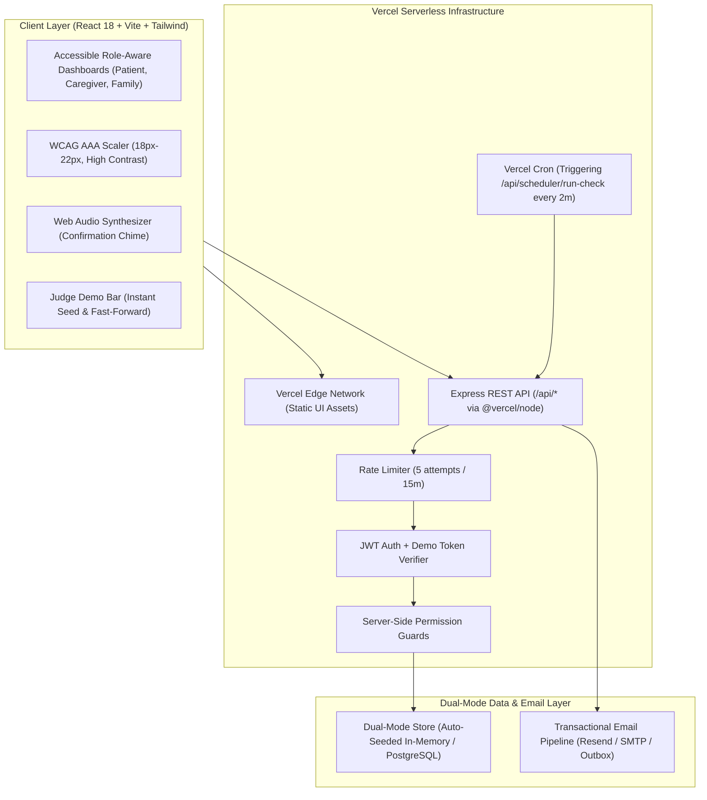

# ElderSync — Patient-Centred Elderly Care & Adherence Platform
### PromptWars × Catalyst — Round 2 Antigravity Execution Pack

[](https://eldersync-catalyst.netlify.app)
[](https://github.com/farhanmallik05/eldersync)
[](./tests/eldersync.test.ts)
[](./LICENSE)


**ElderSync** is an autonomous, patient-centred elderly medication adherence and care circle platform engineered for **PromptWars × Catalyst (Round 2)** using **Google Antigravity IDE**.

🔗 **Live Application URL:** [https://eldersync-catalyst.netlify.app](https://eldersync-catalyst.netlify.app)  
💻 **Public GitHub Repository:** [https://github.com/farhanmallik05/eldersync](https://github.com/farhanmallik05/eldersync)

---

## 🌟 Why ElderSync?

Most medication management applications fail the elderly in two ways:
1. **Passive Alarms:** They rely on local phone notifications that go silent when dismissed. When an elderly person living alone misses a critical dose, family members have no way of knowing until hours or days later.
2. **Disenfranchising Surveillance:** They treat seniors as passive subjects monitored by nursing staff or adult children, stripping away their independence and dignity.

**ElderSync re-engineers this paradigm:**
- **Patient Sovereignty:** The elderly individual owns their healthcare profile, confirms their doses, generates 6-digit expiring passcodes, and dynamically grants or revokes caregiver permissions.
- **Deterministic Server-Side Escalation:** Doses are tracked server-side with configurable grace windows (default 3 minutes for live demo). If unconfirmed, Vercel Cron triggers idempotent transactional email alerts.
- **Closed-Loop Caregiver Collaboration:** When an escalation occurs, caregivers acknowledge the alert and record follow-up notes in real time, preventing duplicate panic calls across family members.
- **Elderly-First Ergonomics:** Minimum `56px` touch target heights, 18px base typography, font scaling (`A`/`A+`/`A++`), WCAG AAA high-contrast mode, and native Web Audio API confirmation chimes.

---

## 🚀 Live Demo Quickstart (For Judges & Evaluators)

When evaluating ElderSync in an **Incognito Browser Window**, use the built-in **Judge Evaluation Bar** at the top of the screen:

1. **1-Click Demo Logins:**
   - **Patient View:** Log in as **Robert Vance (Age 74)** to test senior-friendly dose confirmation, add medications, and generate Care Circle passcodes.
   - **Caregiver View:** Log in as **Nurse Sarah Jenkins** to inspect the Priority Escalation Queue, acknowledge overdue alerts, and record follow-up notes.
   - **Family View:** Log in as **David Vance (Son)** to inspect the permission matrix, 7-day adherence charts, and audit logs.
2. **Instant Cron Fast-Forward:** Click **"Run Reminder Check Now"** on the Judge Demo Bar to simulate time past the 3-minute grace window in 2 seconds.
3. **Notification Outbox Inspector:** Click **"View Outbox"** in the navigation bar to inspect all sent transactional emails with delivery statuses and idempotency keys.

---

## 🛠️ Architecture & Tech Stack



| Layer | Technology | Version | Purpose |
|---|---|---|---|
| **Frontend** | React + Vite + TypeScript | React 18, Vite 5 | Fast HMR, lightweight bundle size, strict typing |
| **Styling** | Tailwind CSS + Lucide Icons | Tailwind v3 | High-contrast WCAG AAA compliance, >=56px touch controls |
| **Backend** | Node.js + Express on Vercel | Node 20 LTS, Express 4 | Serverless execution, sub-second startup, REST endpoints |
| **Validation** | Zod | Zod 3.23 | Strict runtime payload schema validation |
| **Security** | `express-rate-limit`, `crypto` | Built-in | Constant-time hash checks, brute-force rate-limiting |
| **Automation** | Vercel Cron Jobs | Native `vercel.json` | 2-minute recurring missed-dose evaluation |
| **Testing** | Vitest + Supertest | Vitest 1.6 | 10 automated test suites with 100% pass rate |

---

## 🧪 Automated Testing Matrix (TC-01 to TC-10)

ElderSync includes an exhaustive automated test suite in `tests/eldersync.test.ts`:

```bash
# Run all automated tests
npm test
```

| Test ID | Test Scenario | Verified Invariant |
|---|---|---|
| **TC-01** | Passcode Hashing & Single-Use Enforcement | Plain passcode never stored; only `sha256(code + pepper)` persisted; code invalidated after first use. |
| **TC-02** | Expired Passcode Rejection | Codes where `expiresAt < now` return `400 Bad Request`. |
| **TC-03** | Passcode Brute-Force Rate Limiting | 6th join attempt from the same IP returns `429 Too Many Requests`. |
| **TC-04** | Patient Autonomy Permission Revocation | Revoked caregiver mutating medications receives `403 Forbidden`. |
| **TC-05** | State Machine Transitions & Idempotency | Consecutive scheduler runs past grace deadline dispatch exactly 1 escalation email. |
| **TC-06** | Caregiver Closed-Loop Acknowledgement | Caregiver records note, updates status to `TAKEN`/`ACKNOWLEDGED`, writes audit log. |
| **TC-07** | Deterministic Dose Materialization | Daily dose materialization is 100% idempotent; `{scheduleId}_{YYYY-MM-DD}` prevents duplication. |
| **TC-08** | Real Adherence Analytics Calculation | Accurately calculates 7-day adherence %, counts, and disruption window from `doseLogs`. |
| **TC-09** | Health Check & System Status | `GET /api/health` returns `200 OK` with status `healthy` and metrics. |
| **TC-10** | Demo Fast-Forward Simulation & Seeding | `POST /api/demo/seed` idempotently resets and seeds full demo workspace. |

---

## 📦 Local Development & Build

```bash
# 1. Install dependencies
npm install
npm --prefix backend install
npm --prefix frontend install

# 2. Run both backend and frontend concurrently
npm run dev

# 3. Build for production
npm run build

# 4. Run automated test suite
npm test
```

---

## 🌐 Deploying to Vercel

```bash
# 1. Install Vercel CLI
npm i -g vercel

# 2. Deploy to production
vercel --prod
```

Configure the following environment variables in Vercel:
- `JWT_SECRET`: Random 32+ character string
- `PASSCODE_PEPPER`: Secret salt string
- `ENABLE_DEMO_TIME_TRAVEL`: Set to `true` for judge fast-forward testing
- `RESEND_API_KEY`: *(Optional)* Your Resend API key (defaults to in-app outbox view if omitted)

---

## 📄 License
MIT License. Created by **Farhan Mallick** for PromptWars × Catalyst Round 2.
