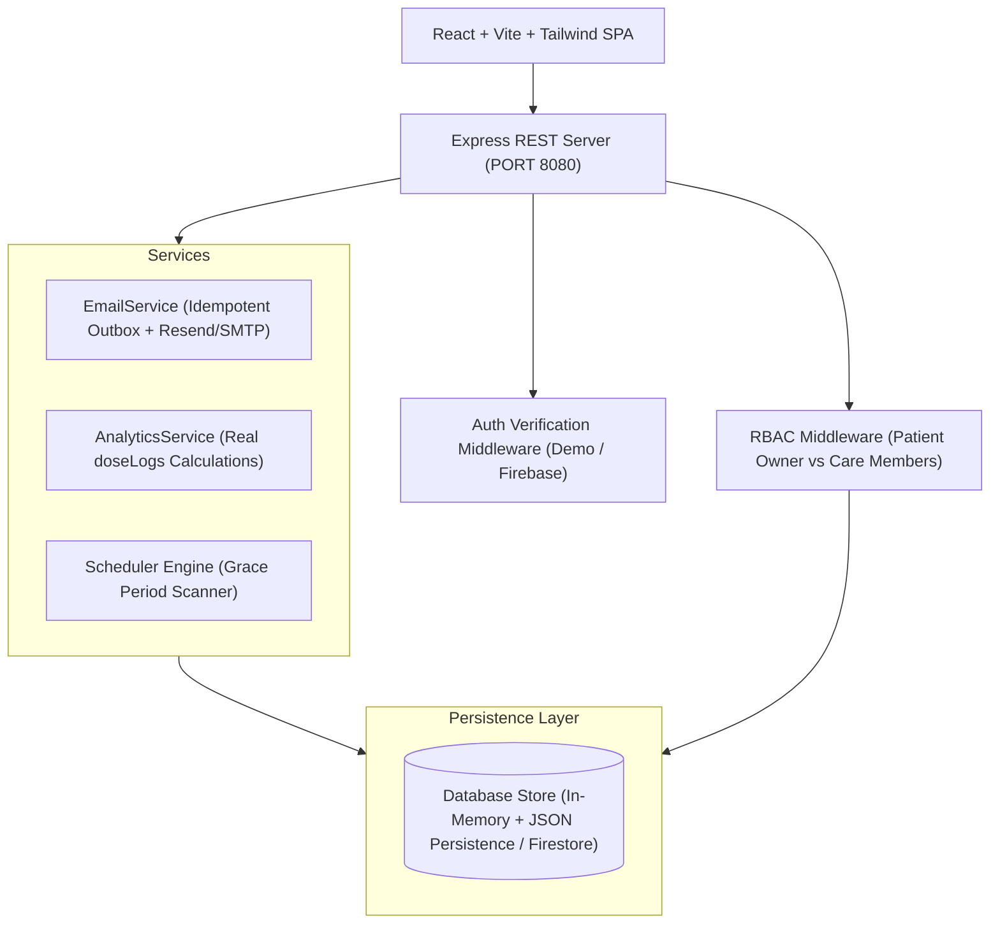

# ElderSync System Architecture

## Architecture Diagram

## Security Invariants

1. **Patient Data Ownership**: Only the patient owner (`ownerUid`) can alter patient autonomy settings, generate passcodes, and toggle or revoke care member permissions.
2. **Cryptographic Passcode Hashing**: Single-use 6-digit invitation passcodes are hashed using `sha256(passcode + PASSCODE_PEPPER)`. The database never stores plaintext passcodes.
3. **Passcode Single-Use & Expiration**: Passcodes expire after 15 minutes and can only be redeemed once. Subsequent redemption attempts return `400 Bad Request`.
4. **Notification Idempotency**: All transactional reminders, escalations, and appointments use deterministic idempotency keys (`rem_${doseId}`, `esc_${doseId}`, `appt_${appointmentId}`) to guarantee zero duplicate alerts.
5. **Closed-Loop Caregiver Verification**: Unconfirmed doses escalated past the grace period require explicit acknowledgement and follow-up notes, recording caregiver identity and timestamp in immutable audit logs.
